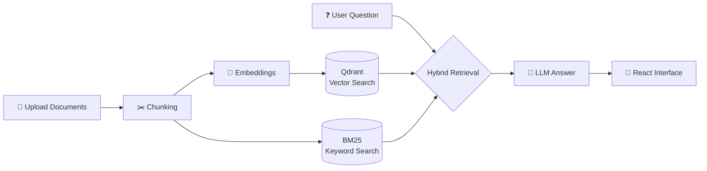
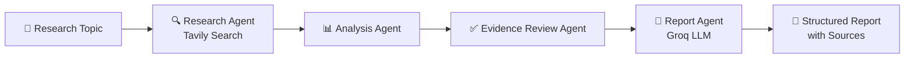
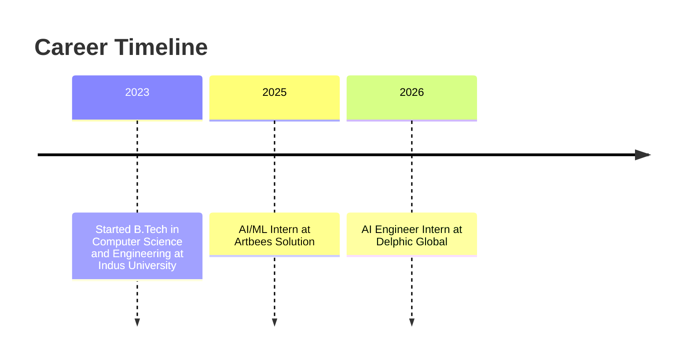

<!-- ===================== HEADER ===================== -->
<div align="center">



<a href="https://github.com/utsavi-narola45">
  
</a>

<br/>

[](https://www.linkedin.com/in/utsavi-narola-609117389)
[](mailto:utsavinarola45@gmail.com)
[](https://github.com/utsavi-narola45)


</div>


## ⚡ At a Glance

| | |
|---|---|
| 🧠 **Role** | AI Engineer Intern @ **Delphic Global** |
| 🎓 **Education** | B.Tech CSE, Indus University · CGPA **9.47 / 10** |
| 🔧 **Core stack** | Python · FastAPI · LangChain · LangGraph · RAG · PostgreSQL · Qdrant · Docker · React |
| 📍 **Location** | Ahmedabad, India |
| 🎯 **Looking for** | Entry-level AI Engineer roles |


## 👩‍💻 About Me

I build **LLM-powered applications end to end**: from document ingestion and retrieval, to agent orchestration, to the API and interface people actually use.

My work centers on three things:

- **Retrieval** that finds the right context (chunking, embeddings, hybrid vector + BM25 search)
- **Agentic workflows** where specialised agents collaborate on a task (LangGraph)
- **Practical delivery**: FastAPI backends, React frontends, PostgreSQL and Docker


## 🛠️ Tech Stack

<div align="center">


</div>

| Area | Skills |
|---|---|
| 🤖 **Agentic AI & LLMs** | LangChain, LangGraph, tool-use agents, prompt engineering |
| 🔎 **RAG & Search** | Embeddings, vector search, BM25 hybrid retrieval, Qdrant, chunking & ingestion |
| ⚙️ **Backend** | Python, FastAPI, REST APIs, authentication, PostgreSQL |
| 🎨 **Frontend** | React, Webflow, HTML, CSS |
| 🚢 **Tools** | Docker, Git, GitHub |


## 🚀 Featured Projects

### 1️⃣ RAG-Based Document Q&A System

Upload documents and ask questions grounded in their content, using hybrid retrieval for better relevance.



**Stack:** `Python` `FastAPI` `React` `LangChain` `LangGraph` `PostgreSQL` `Qdrant`
**Highlights:** document processing pipeline · hybrid retrieval (vector + BM25) · FastAPI ↔ React integration

🔗 **[View Repository](https://github.com/utsavi-narola45/cognifyai)** · 🎥 **[Demo](https://utsavi-narola45.github.io/cognifyai/)**

<br/>

### 2️⃣ Multi-Agent AI Research Assistant

A team of LangGraph agents that research a topic, analyse findings, review evidence and generate a structured report with source references.



**Stack:** `Python` `FastAPI` `LangGraph` `Groq` `Tavily` `React`
**Highlights:** multi-agent orchestration · web search integration · source-referenced reports

🔗 **[View Repository](https://github.com/utsavi-narola45/questora-ai)** · 🎥 **[Demo](https://utsavi-narola45.github.io/questora-ai/)**


## 💼 Experience



| Role | Company | Focus |
|---|---|---|
| **AI Engineer Intern** · Aug 2026 – Present | Delphic Global | AI applications with Python, FastAPI and LLMs; RAG, embedding and retrieval workflows for automated Q&A and search; LangChain, LangGraph, PostgreSQL, Docker |
| **AI/ML Intern** · Jun 2025 | Artbees Solution | AI/ML project work, data analysis and machine-learning techniques in a collaborative team |


## 🏆 Certifications

[](#)
[](#)
[](#)
[](#)

## 📊 GitHub Stats

<div align="center">


</div>


## 🎯 Current Focus

```python
class Utsavi:
    role      = "AI Engineer Intern"
    building  = ["RAG systems", "multi-agent workflows"]
    exploring = ["hybrid retrieval and reranking", "agentic workflows with LangGraph"]
    open_to   = "Entry-level AI Engineer roles"
```


<div align="center">

### 🤝 Let's build something intelligent together

[](https://www.linkedin.com/in/utsavi-narola-609117389)
[](mailto:utsavinarola45@gmail.com)


</div>
